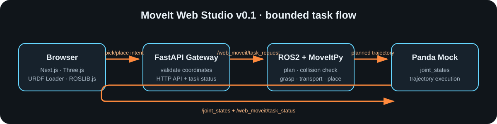

[← 第二个月 MoveIt](../README.md) · [返回主页](../../../README.md) · **中文** | [English](README.en.md)

# 05 · MoveIt Web Studio：在网页上创建一次机械臂抓取任务

到了第二个月，我不想把成果停在“我能在 RViz 点一下 Plan & Execute”。真正想验证的是：一个不懂 ROS2 命令行的人，能不能在网页上选择物体和目标位置，然后看到 Panda 机械臂完成一次受控的取放？

`MoveIt Web Studio v0.1` 就是这个问题的答案。它不是遥操作系统，也不是面向真实机器人部署的控制台；它是一个边界明确、能跑通全链路的产品原型：**网页创建任务 → 网关验证输入 → MoveIt 规划并执行 → 浏览器显示机械臂状态与任务进度。**



> 上图只是链路图，不是替代 RViz 的渲染截图。实际运行时，在浏览器打开 `http://localhost:3002`。

## 这次做成了什么

- **网页建任务**：填写抓取点和放置点的 X/Y/Z 坐标，点击“规划并执行”。
- **真实 ROS2 连接**：浏览器使用 `ROSLIB.js` 订阅 `/joint_states`；Panda 的关节角同步到 Three.js 中加载的 URDF。
- **可见任务过程**：橙色方块是被抓物，蓝色圆柱是目标位置；任务进入搬运阶段时，方块会向目标移动，状态卡显示 MoveIt 执行进度。
- **受限后端**：FastAPI 只允许取放位置落在演示工作空间；它不向浏览器暴露 `move_group`、shell 或任意 ROS topic。
- **MoveIt 执行器**：使用本月已经学过的 `MoveItPy`，依次靠近、闭爪、搬运、开爪、撤离并回到 `ready`。

## 为什么不是让网页直接控制 `move_group`

如果网页能够直接发布任意 ROS 消息，那么“填写一个坐标”很快会变成“网页获得了机器人系统的全部权限”。这在学习项目中也不是一个好架构。

这里把能力分为三层：

```text
浏览器：表达意图（从哪里拿、放到哪里）
FastAPI：校验意图、保存任务状态、提供 HTTP/WebSocket API
ROS2 + MoveIt：把合法意图变成无碰撞轨迹，并由 mock controller 执行
```

这使网页只是“任务界面”，MoveIt 仍是唯一的规划和执行决策者。将来换成真实机械臂时，安全校验、急停和权限控制也应继续放在机器人侧，而不是放到浏览器里。

## 项目结构

```text
moveit_web_studio/
├── frontend/                         # Next.js + React Three Fiber 前端
│   ├── app/page.tsx                  # 任务表单、连接状态和任务进度
│   ├── components/RobotScene.tsx     # Three.js 场景、URDF Loader、ROSLIB.js
│   └── public/robot/panda_web.urdf   # 浏览器使用的轻量 Panda URDF
├── backend/                          # FastAPI 到 ROS2 的受限网关
│   └── app/ros_bridge.py             # 发布任务、接收状态和 joint_states
└── docker-compose.yml                # 一条命令启动整套演示

ros_ws/src/moveit/hello_moveit_py/
├── launch/web_moveit.launch.py       # move_group、mock controller、rosbridge
└── hello_moveit_py/web_task_executor.py  # MoveItPy 抓取流程
```

## 先用 Docker 跑起来

在仓库根目录执行：

```bash
docker compose -f moveit_web_studio/docker-compose.yml up --build
```

第一次会下载 ROS2 Jazzy、MoveIt、Panda 配置和前端依赖，需要耐心等待。启动成功后打开：

```text
http://localhost:3002
```

页面右上角从“等待机器人”变成“机器人在线”后，使用默认坐标就能提交第一个任务。后端 API 位于 `http://localhost:8001`，浏览器的 ROSLIB WebSocket 位于 `ws://localhost:9092`。

停止运行：

```bash
docker compose -f moveit_web_studio/docker-compose.yml down
```

## 不使用 Docker 的实验步骤

环境要求：Ubuntu 24.04、ROS2 Jazzy、Node.js 20+。先安装系统依赖：

```bash
sudo apt update
sudo apt install ros-jazzy-moveit \
  ros-jazzy-moveit-resources-panda-moveit-config \
  ros-jazzy-rosbridge-suite
```

**终端一：启动 MoveIt、mock 控制器和 rosbridge。**

```bash
source /opt/ros/jazzy/setup.bash
cd ~/develops/embodied-ai-journey/ros_ws
colcon build --packages-select hello_moveit_py
source install/setup.bash
ros2 launch hello_moveit_py web_moveit.launch.py
```

**终端二：启动 FastAPI 网关。**

```bash
source /opt/ros/jazzy/setup.bash
cd ~/develops/embodied-ai-journey
source ros_ws/install/setup.bash
python3 -m pip install --user --break-system-packages -r moveit_web_studio/backend/requirements.txt
python3 -m uvicorn app.main:app --app-dir moveit_web_studio/backend --host 0.0.0.0 --port 8001
```

这里**不要使用普通 Python `venv`**。`rclpy` 是 ROS2 Jazzy 的系统 Python 包，不能通过 `pip install rclpy` 安装；如果提示符前有 `(venv)`，先运行 `deactivate`，再 source `/opt/ros/jazzy/setup.bash`。不要用 `PYTHONPATH=...` 覆盖 ROS2 已设置的 Python 路径；`--app-dir` 只告诉 Uvicorn 在哪里寻找 `app`。

**终端三：启动网页。**

```bash
cd ~/develops/embodied-ai-journey/moveit_web_studio/frontend
npm install
npm run dev
```

然后访问 `http://localhost:3000`。本机开发的默认前端端口是 3000；Docker 为避免与第一个月的 Dashboard 冲突，映射为 3002。

## 第一次实验应该看到什么

1. 打开网页后，可用鼠标旋转、缩放 Three.js 场景。
2. `ROSLIB` 显示 `ws://localhost:9090`，状态为“机器人在线”。这说明 `/joint_states` 正在到达浏览器。
3. 默认橙色方块在 `x=0.45, y=-0.20, z=0.03`，蓝色圆柱在 `x=0.25, y=0.35, z=0.03`。
4. 点击“规划并执行”。状态依次经过 `queued`、`planning`、`grasping`、`transporting`、`placing`、`returning`，最后是 `succeeded`。
5. Panda 的 URDF 模型随真实 `/joint_states` 转动；方块在搬运阶段向目标位置过渡。这是 UI 对任务状态的解释性显示，真正的无碰撞轨迹仍由 MoveIt 计算。

如果还想同时看更底层的规划效果，可在终端一中额外启动 RViz：

```bash
rviz2
```

然后添加 `MotionPlanning` Display，Fixed Frame 设为 `world`。网页和 RViz 分别回答不同问题：网页展示“产品使用者如何提交任务”，RViz 用于调试“MoveIt 怎样理解并规划任务”。

## 一项网页任务在 ROS2 中如何执行

`web_task_executor.py` 订阅 `/web_moveit/task_request`。收到经过 FastAPI 校验的 JSON 后，它会执行下面的固定流程：

```text
添加碰撞方块
  → 规划到抓取点上方
  → 移除方块的世界碰撞（进入抓取接触区）
  → 下降到抓取高度并闭合手爪
  → 抬起并移动到放置点
  → 下降、张开手爪、撤离
  → 回到 ready
```

每一步都会向 `/web_moveit/task_status` 发布状态。FastAPI 订阅它并更新 `/api/tasks`；网页轮询 API 显示最新进度。网页还通过 `ROSLIB.js` 直接订阅 `/joint_states`，因此即使不经过 FastAPI，也能拿到每一个关节的真实 mock 状态。

## 这里的“安全边界”是什么

`web_task_executor.py` 限制 X/Y 为 `[-0.7, 0.7] m`，Z 为 `[0.03, 0.65] m`，并且队列大小为 1。超出范围或在忙碌时提交，会得到拒绝状态。这个限制不能替代真实硬件的碰撞检测、速度限制、急停、身份认证或网络隔离；它只是把“学习网页”与“任意 ROS 控制台”隔离开的第一层。

本版本使用 `panda_arm_controller` 与 `panda_hand_controller` 的 mock controller。**不要把这一套 Docker 配置直接连接到真实机器人。** 接真实硬件前至少要增加认证、操作人确认、速度/力限制、独立急停和经过验证的工作空间限制。

## 常见问题

- **页面一直是“等待机器人”**：查看终端一是否有 `joint_state_broadcaster`、`panda_arm_controller` 和 `panda_hand_controller` 都为 active；同时检查 `rosbridge_websocket` 是否在运行。
- **`No module named 'rclpy'`**：FastAPI 被普通 venv 启动了。停止 Uvicorn，执行 `deactivate`，source ROS2 和工作空间环境后，用系统 `python3 -m uvicorn` 重启。
- **出现 `NetworkError`**：确认网页端口与 API 设置一致。Docker 页面应为 `http://localhost:3002`，API 为 8001，WebSocket 为 9092。本机网关允许从 `localhost`、`127.0.0.1` 和主机名 `gpu` 的网页端口访问；修改后需重启 Uvicorn。
- **任务状态变成 `failed`**：先看 `web_task_executor` 的报错。大概率是目标不可达或当前场景碰撞；先改用页面默认坐标复现。
- **端口已占用**：本项目默认使用 `3002`、`8001`、`9092`。如 9092 已被占用，需同时修改 launch、Compose 端口映射与 `NEXT_PUBLIC_ROSBRIDGE_URL`。
- **网页模型不动**：运行 `ros2 topic echo /joint_states --once` 验证 ROS2 是否有关节消息；再确认浏览器开发者工具中 WebSocket `ws://localhost:9092` 已连接。

## 从这次成果学到什么

一个机械臂网页并不是“在 Three.js 里画一个手臂”就完成了。Three.js 负责让人理解当前状态，ROSLIB.js 提供浏览器到 ROS2 的状态通道，FastAPI 负责把网页输入变成受限任务，MoveIt 负责真正困难的规划、碰撞检查和控制器执行。把这四层分开，才有可能在后续把 mock Panda 替换成真实硬件，而不用把整套 UI 推倒重来。

## 下一步

`v0.1` 的坐标来自数字输入框。后续可以增加点击地面选点、任务历史回放、摄像头/点云视图和用户权限；但这些功能都应该继续遵循这次确立的原则：**网页表达意图，机器人侧验证并执行。**
