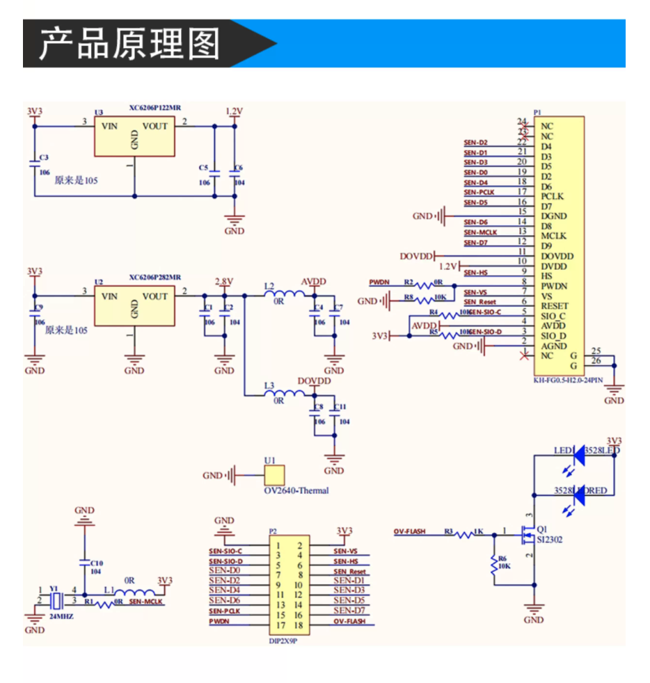
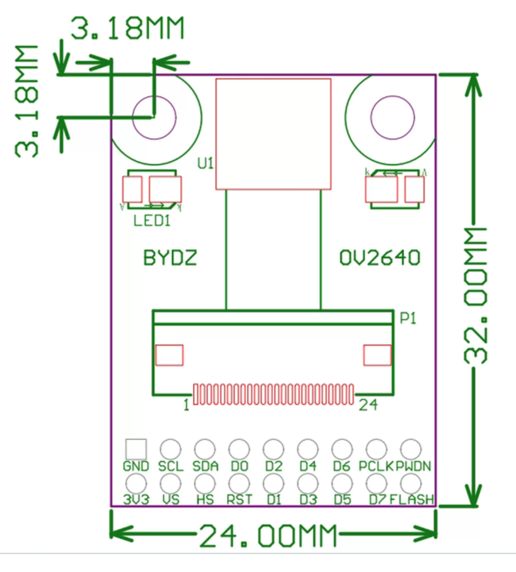

[← 风扇机器人](../README.md) · [主页](../../../README.md) · **中文** | [English](README.en.md)

# 01 · ESP32-S3 与 OV2640：给机器人第一双眼睛

## 为什么第一步不是训练模型

之前的网球实验从电脑摄像头拿图像。这次相机要装到机器人上，事情变成了两步：开发板先从传感器接收图像，再把它传给电脑。

我先把目标缩到可以验收的一句话：**在浏览器里看见相机前的手，保存一张照片，并在连接失败时知道该查哪一层。** 这一节没有手部识别、目标距离、自动追踪、轮子控制或强化学习；看见画面不等于理解画面。

## 先确认我们真正拿到的硬件

沟通时最初提到 OV5640，之后实际确认的是 **OV2640**。当前按后者进行实验：ESP32-S3 N16R8 开发板 + OV2640 相机模块。

`N16R8` 表示此类模组的 16 MB Flash、8 MB PSRAM 配置，不是相机引脚表。OV2640 是约 200 万像素传感器，OV5640 是约 500 万像素；商品标题同时出现两者，并不能确认购买的具体 SKU。固件会在初始化后读取传感器 PID，支持这两种传感器，但不能据此推断接口、电压或排线兼容。

确认硬件时经历了一次图片更正：最初提供的商品图写着 OV5640，但用户随后说明传错了，并提供真实模块正反面照片。**目前以新照片和原理图为准：正面是 `BYDZ / OV2640`，背面是 `BY-OV2640-V1.5`。这是带配套接口及外围电路的OV2640模块，摄像头排线接入模块插座；之前“OV5640转接板是否能装OV2640”的疑问不再适用于这套硬件。**

这也提醒我：网上相似商品图不能代替实物板号。接下来不用因为误传照片就重新买板；先按实际OV2640板的丝印整理接线，再核对排线方向与时钟。

照片里可以直接读到：

- 开发板是双 USB-C 的 ESP32-S3 N16R8 外形，没有看到能直接插相机排线的插座。
- 新的蓝色模块有24触点相机插座及2×9排针，背面标着 `BY-OV2640-V1.5`，并有标号 `Y1` 的时钟器件。
- 排针有 `PCLK`，**没有 `XCLK`**，这与下文普通“由ESP32提供XCLK”的方案不同。
- 新照片中还没有安装镜头。安装前核对单独购买镜头的FPC引脚、触点面和插入方向，不按软排线外观随意翻转。

### 原理图终于回答了“谁给相机提供时钟”

后续提供的原理图在左下角明确标出了 **Y1 = 24MHz**。顺着网络名追下去：

```text
Y1输出（3脚）→ R1（0Ω）→ SEN-MCLK → P1的13脚MCLK → OV2640
```

因此，这套模块使用**板载24MHz时钟**，不是由ESP32的GPIO15输出时钟。这个数值现在来自模块原理图，而不是凭经验猜测。P2的18针接口与前面实物丝印一致，FLASH则连接补光LED的开关电路，不是时钟。图中3.3V输入经板上稳压电路产生2.8V和1.2V；使用配套模块时不需要自行把这些内部电源引到ESP32。





资料确认之后，接线保持断电完成，再按方案B启用。用户已经反馈 **PSRAM为8388608字节、热点可连接、网页可打开**。这证明程序和网络部分正常，但尚不等于相机已经取到图像；下一步才是打开采集开关并重新上传。

### 按照片读取排针，而不是套网上的脚位图

以**镜头朝向自己、排针位于图片下方**为视角，从左到右，板上焊点丝印是：

```text
靠近镜头的一排：GND  SCL  SDA  D0   D2  D4  D6  PCLK PWDN
远离镜头的一排：3V3  VS   HREF RST  D1  D3  D5  D7   FLASH
```

`VS` 对应 VSYNC，`RST` 对应 RESET，`PWDN` 是相机休眠控制。`FLASH` 是补光控制相关标识，**不是Flash存储器数据脚，也不是XCLK**，本实验先不连接。`3V3` 是3.3V电源标识，不接5V；模块和镜头是否匹配仍需先确认。翻到背面看排针时左右会反转，不能照着背面外观直接抄这张正面视角表。

下文保留普通外部XCLK方案作为对照；当前模块使用**方案B：板载24MHz**。频率已由原理图确认，真实JPEG画面仍待实物验证。

先核对这些事情：

- 相机是带排针、稳压等电路的模块，还是只有软排线的裸镜头？后者通常需要匹配的连接器、转接板和供电，不能当排针模块接。
- 模块支持 DVP 并行输出吗？MIPI 模块或带专用 SPI/FIFO 控制器的模块不能直接套用本代码。
- 模块供电端标的是 `3V3`、`5V` 还是 `VCC`？查商家原理图后再供电。裸传感器还涉及多个电压域，不能随便接 3.3V 或 5V。
- 相机数字信号必须与 ESP32-S3 的 3.3V I/O 兼容；5V 电源输入不代表数据脚也是 5V 兼容。
- `RESET/RST`、`PWDN` 是否引出、是否板上已处理？模块若用自带振荡器提供时钟，也要先核对，不要向已有输出的时钟脚反向驱动。
- 第一次实验先断开小智套件里的屏幕、麦克风、功放等外设，避免引脚冲突；**不要连接电机或风扇**。

## 原理：相机怎样把世界送进浏览器

```text
OV2640
  ├─ SCCB：设置曝光、分辨率、JPEG 等寄存器
  └─ DVP：D0～D7 + 同步时钟，把图像送给 ESP32-S3
            ↓
      JPEG 帧缓冲区（PSRAM）
            ↓
      HTTP /capture 或 MJPEG /stream
            ↓
      浏览器 / 电脑 Python 程序
```

SCCB 的 SDA/SCL 是配置通道，不负责把整张图像传给电脑；DVP 的多根数据线才承担图像传输。`XCLK` 是提供给相机的时钟，`PCLK` 是相机输出的数据时钟，不能互换。

这里选择 JPEG，而不是让 ESP32 通过 Wi-Fi 传输大量原始 RGB 数据。视频使用 MJPEG：连续发送一张张 JPEG，浏览器直接显示，不需要先搭建 WebRTC 或视频编码服务器。第一版是局域网实验，**不是 USB 摄像头，不会自动出现在电脑的 `/dev/video0` 中**。

## 代码在哪里，分别做什么

| 文件 | 作用 |
|---|---|
| [`esp32_camera.ino`](../../../ros_ws/src/fan_robot/firmware/esp32_camera/esp32_camera.ino) | 读取相机、启动 Wi-Fi 与网页服务；每次取帧后归还帧缓冲区 |
| [`camera_config.example.h`](../../../ros_ws/src/fan_robot/firmware/esp32_camera/camera_config.example.h) | 接线、网络、镜像和帧率设置的示例 |
| [`camera_config.onboard_clock.example.h`](../../../ros_ws/src/fan_robot/firmware/esp32_camera/camera_config.onboard_clock.example.h) | 无XCLK引出时的候选配置；需先确认镜头与转接板兼容及实际时钟 |
| [`camera_config.by_ov2640_v15.example.h`](../../../ros_ws/src/fan_robot/firmware/esp32_camera/camera_config.by_ov2640_v15.example.h) | 当前模块的专用模板：板载24MHz，读者自行确认接线后启用 |
| [`camera_client.py`](../../../ros_ws/src/fan_robot/tools/camera_client.py) | 电脑端检查、保存 JPEG、可选 OpenCV 预览；不依赖 PyTorch |

嵌入式端使用 Arduino C++，电脑端使用 Python。这里没有把 Arduino 固件伪装成 Python 脚本；普通 MicroPython 也不保证自带这套相机驱动。代码放在 ROS2 工作空间中方便统一管理，但本实验暂时不需要 ROS2，更不需要 `colcon build`。

## 实验一：准备配置与接线

在仓库根目录运行：

```bash
cd ros_ws/src/fan_robot
cp -i firmware/esp32_camera/camera_config.by_ov2640_v15.example.h \
      firmware/esp32_camera/camera_config.local.h
```

本地配置文件已被Git忽略，Wi-Fi密码不会默认进入提交。`-i`在已有配置时询问是否覆盖，保留自己的密码和改动。以上命令面向当前BY-OV2640-V1.5模块；别的板型先核对资料再选通用模板。固件优先加载本地配置；没有它时仍使用未确认的通用示例，不会自动猜测硬件。

### 方案A：有外部XCLK输入的独立DVP模块

相机丝印的名称是**信号名称**，不是某个排针的固定物理脚位。请按模块资料找对应脚。ESP32 端使用板上 `GPIO/IO` 编号，而不是从上往下数第几个孔。

| 相机信号 | ESP32-S3 GPIO | 配置项 |
|---|---:|---|
| D0 / Y2 | 4 | `data_pins[0]` |
| D1 / Y3 | 5 | `data_pins[1]` |
| D2 / Y4 | 6 | `data_pins[2]` |
| D3 / Y5 | 7 | `data_pins[3]` |
| D4 / Y6 | 8 | `data_pins[4]` |
| D5 / Y7 | 9 | `data_pins[5]` |
| D6 / Y8 | 10 | `data_pins[6]` |
| D7 / Y9 | 11 | `data_pins[7]` |
| XCLK | 15 | `xclk_pin` |
| PCLK | 13 | `pclk_pin` |
| VSYNC | 16 | `vsync_pin` |
| HREF | 17 | `href_pin` |
| SIOD / SDA | 18 | `sda_pin` |
| SIOC / SCL | 21 | `scl_pin` |
| PWDN | 12 | `power_down_pin` |
| RESET / RST | 14 | `reset_pin` |
| GND | GND | 共地 |
| 模块电源 | 按模块原理图确认 | **不凭商品标题接线** |

这是我们可以选择的接线，不是“所有 ESP32-S3 相机的标准接线”。如果模块直接插在板载相机插座上，应改用该板的原理图映射，不能使用这张表。如果数据脚写成 D2～D9，也不要只按数字平移，先核对它们对应的是不是 Y2～Y9。

**照片中的18针板没有XCLK引出，不按方案A把GPIO15接到其他脚，尤其不能接FLASH或PCLK。**

本方案避开原生 USB 的 GPIO19/20、常见启动配置脚，以及 N16R8 模组的 Flash/PSRAM 占用区域。即便如此，也要核对开发板是否引出并占用了这些脚。特别不要把 GPIO26～37 当作在 N16R8 上可以任意分配的普通脚。

接线时断电，线尽量短、连接牢靠；DVP 的高速并行信号不适合拖很长的杜邦线。只有确认接口、供电、所有 GPIO 都匹配并完成接线后，才在 `camera_config.local.h` 中将 `wiring_confirmed` 改成 `true`。默认 `false` 是刻意的保护：允许先查看网络诊断页，但不驱动相机引脚。

如果 PWDN/RESET 未引出且模块已按原理图正确处理，可将对应项设为 `-1`，**不是把未知、悬空的控制脚一律忽略**。

### 方案B：BY-OV2640-V1.5板载24MHz（当前使用）

用户提供的模块原理图确认了Y1的24MHz及SEN-MCLK连接，因此当前使用这个方案，不再停留在“板载频率待确认”。

确认后可以保留方案A中数据、同步、SCCB、RST和PWDN的GPIO分配，**省去GPIO15的XCLK连线，FLASH不接**。结合照片中的名字，接线如下：

| 排针丝印 | ESP32-S3 GPIO/电源 | 备注 |
|---|---|---|
| GND | GND | 共地 |
| 3V3 | 稳定3.3V电源 | 按板上丝印，核对开发板稳压器的供电余量；不接5V |
| SCL / SDA | 21 / 18 | SCCB配置通道 |
| VS / HREF / PCLK | 16 / 17 / 13 | 同步与数据时钟 |
| RST / PWDN | 14 / 12 | 不是固定接地或接高电平 |
| D0 / D1 / D2 / D3 | 4 / 5 / 6 / 7 | 严格按信号名，不按排针连续顺序接 |
| D4 / D5 / D6 / D7 | 8 / 9 / 10 / 11 | 同上 |
| FLASH | 不接 | 第一版不控制补光 |
| XCLK | 没有此排针，不接GPIO15 | 由经确认的转接板时钟提供 |

如果还没有本地配置，在 `ros_ws/src/fan_robot` 下复制当前模块专用模板，不同时加载多份：

```bash
cp -i firmware/esp32_camera/camera_config.by_ov2640_v15.example.h \
      firmware/esp32_camera/camera_config.local.h
```

`-i` 会在已有本地配置时询问是否覆盖。先保留自己的密码及引脚修改，再决定是否覆盖。

专用模板已经设置 `onboard_clock_confirmed = true`、`xclk_frequency_hz = 24000000`、`xclk_pin = -1`，但仍保留 `wiring_confirmed = false`，防止其他读者在没接线时直接初始化。确认按表完成接线后，在自己的本地配置中使用：

```cpp
constexpr bool wiring_confirmed = true;
constexpr bool onboard_clock_confirmed = true;
constexpr int xclk_frequency_hz = 24000000;
constexpr int xclk_pin = -1;
```

**本机的私有配置已按上述值更新**，没有改动Wi-Fi凭据和已有引脚。下一步必须重新编译并上传 `.ino`，仅保存文件不会改变开发板里的旧程序。通用 `camera_config.onboard_clock.example.h` 仍保留0和未确认保护，它是其他未知板型的模板，不是本模块的已知配置。

`xclk_pin = -1` **不等于** `xclk_frequency_hz = 0`。驱动仍要用时钟频率计算内部参数，不能把0传进去。代码会在初始化前检查时钟来源与频率，不明时停在诊断状态。已经用旧模板创建本地配置的读者，还需要在 `camera_settings` 命名空间中补上 `constexpr bool onboard_clock_confirmed = false;`；普通外部XCLK方案可保留该值为false。

24MHz及连接路径依据是上方用户提供的产品原理图。软件对负值XCLK引脚的支持另见乐鑫驱动：[相机初始化](https://github.com/espressif/esp32-camera/blob/master/driver/esp_camera.c)、[ESP32-S3相机底层](https://github.com/espressif/esp32-camera/blob/master/target/esp32s3/ll_cam.c)。这两类依据分别回答硬件如何接、软件如何配置，不能相互替代。

## 实验二：编译与上传

1. 安装 Arduino IDE 2，在“首选项 → 附加开发板管理器网址”加入乐鑫稳定版地址：

   ```text
   https://espressif.github.io/arduino-esp32/package_esp32_index.json
   ```

2. 在开发板管理器安装 **esp32 by Espressif Systems**。本实验以 **3.3.12** 为编译验证目标；`esp_camera.h` 随该开发板包提供，不需要安装网上来源不明的同名库。
3. 打开 `firmware/esp32_camera/esp32_camera.ino`，保持草图目录名称 `esp32_camera` 不变。
4. 对普通 ESP32-S3-WROOM-1-N16R8 开发板，选择 `ESP32S3 Dev Module`、`Flash Size = 16MB`、`PSRAM = OPI PSRAM`。分区表选适合16MB Flash的选项；专用开发板优先遵循厂商设置，不把不同板型的参数混用。
5. 使用原生 USB 口时，根据板型设置 `USB CDC On Boot = Enabled`；使用 USB-UART 桥接口则按该接口选串口，不能仅凭端口外形判断。默认上传速度不稳定时可降到115200。
6. 上传并打开115200波特率串口监视器，按 RESET 查看启动日志。无法进入下载模式时，按住 BOOT，短按 RESET，再松开 BOOT，随后上传。

上传会替换现有小智程序。如果想保留原功能，先保留原固件和配置恢复方法。这一步只是独立相机实验，不是给小智原固件打补丁。

第一次即使还没连接相机，也能保留 `wiring_confirmed = false` 上传，验证 USB、串口、网络和网页这一半链路。此时应看到 `wiring_not_confirmed`，**这不是相机已经工作**。

## 实验三：浏览器看到实时画面

默认使用开发板热点，不需要输入家里 Wi-Fi 密码：

```text
热点：FanRobot-Camera
密码：fanrobot123
网页：http://192.168.4.1/
```

用手机或电脑连接热点，遇到“无互联网连接”请选择保持连接。热点用于直接访问开发板，不是让开发板共享互联网。手机可能自动切回流量，电脑的代理/VPN也可能绕开局域网，排错时先关闭这些干扰。

网页显示状态，点击“开始视频”查看 MJPEG；“停止视频”后可打开一张照片。没有确认接线时，网页只显示诊断，不会有相机画面。默认热点密码是公开实验密码，需要时在本地配置修改。

| 地址 | 内容 |
|---|---|
| `http://192.168.4.1/` | 中文预览页 |
| `http://192.168.4.1/health` | 相机是否初始化成功、传感器型号、PSRAM和堆内存信息 |
| `http://192.168.4.1/capture` | 一张 JPEG |
| `http://192.168.4.1:81/stream` | MJPEG 视频，端口81而不是80 |

启用并上传之后，串口应打印 `Camera clock: onboard, 24000000 Hz (XCLK GPIO -1)`。如果采集初始化成功，还会出现 `Camera ready: OV2640` 与 `Camera status: ready`，再点网页的“开始视频”。`/health` 同时给出 `xclk_source: onboard` 和 `xclk_frequency_hz: 24000000`，方便判断是否仍在运行旧配置；这些字段显示的是配置值，不是现场频率测量。

视频使用单独的 HTTP 服务，避免持续流阻塞整个预览页。相机缓冲区有互斥保护，但第一版仍建议**一次只用一个视频客户端**，做 Python 实验前先停止浏览器视频。`/health` 的 `camera_ready` 表示初始化成功，不是持续视频保活证明；最终还需要实际取帧验收。

需要接入家里网络时，在本地配置设置 `use_access_point = false`，填写 `wifi_name` 与 `wifi_password`，重新上传。使用 **2.4GHz Wi-Fi**，电脑和开发板在能互通的同一局域网。串口会打印新的 IP，以下 Python 命令也必须相应更换。连接超时会退回热点模式，不会永远卡在等待 Wi-Fi。

这不是加密、带登录的远程监控服务，不要做公网端口映射；画面中也尽量不要包含其他人的隐私。

## 实验四：用 Python 保存第一张照片

仍在 `ros_ws/src/fan_robot` 目录，普通 Python 3 即可，不需要 ROS2、Ultralytics 或 PyTorch：

```bash
python3 tools/camera_client.py --url http://192.168.4.1 check
python3 tools/camera_client.py --url http://192.168.4.1 snapshot \
  --output captures/first.jpg
```

第一条应输出 `camera_ready: true`，传感器应为 `OV2640`；第二条保存真实相机返回的 JPEG。工具不会覆盖已有文件，重复拍摄请换文件名。它会检查响应类型和 JPEG 标记，但标记检查不是完整图像解码，最终要打开照片检查内容。

如果使用 Ubuntu GPU 主机运行 Python，连接相机网络的必须是**那台主机**。你的 Mac 能访问开发板，不代表另一台 Ubuntu 主机也能访问 `192.168.4.1`；跨机器实验建议用家庭局域网模式。

可选的电脑窗口预览才需要 GUI OpenCV：

```bash
python3 -m venv .venv
source .venv/bin/activate
env -u PYTHONPATH python -m pip install -r tools/requirements.txt
python tools/camera_client.py --url http://192.168.4.1 view --fps 5
```

按 `s` 保存当前帧，按 `q` 退出。这是按指定速率轮询 `/capture` 的简单预览，不是重新训练模型，也不代表相机或整条链路一定达到5 FPS。不要为了预览安装 `opencv-python-headless`，它不提供窗口功能；无桌面的SSH环境直接用浏览器或 `snapshot`。

## 验收：怎样才算真的“看见”了

依次完成这些观察，而不是只看一条 `ready` 日志：

1. 状态里确实识别为 OV2640，N16R8 的 PSRAM被识别出来。
2. 浏览器连续预览约1分钟，画面能随手的移动更新，无明显花屏或持续重启。
3. 保存的照片能正常打开，内容与相机前的场景一致。
4. 关闭视频再重新打开，确认缓冲区归还、网络重连没有立即卡死。
5. 遮住镜头再松开，观察曝光恢复；快速挥手，观察延迟，而不是把延迟造成的滞后误认为未来模型没有识别到。

**验证记录：13项客户端模拟HTTP测试与1项主机C++时钟/板型配置保护测试通过。整个Arduino固件已在本机用Arduino-ESP32 3.3.12编译通过，使用本地已启用的24MHz配置，目标为ESP32S3 Dev Module、16MB Flash、OPI PSRAM、Hardware CDC and JTAG、CDC On Boot Enabled及16M Flash分区。固件约占用983KB，静态内存约56.5KB。用户已自行上传，并确认8MB PSRAM、热点网页和真实视频图像正常，采集与传输链路已经跑通。Python拍照、实际帧率及长时间稳定性仍需单独验收，不能由“网页有图”推断它们也全部通过。**

## 排错：按链路定位，不一上来重装 Python

| 现象 | 优先检查 |
|---|---|
| 编译报 `ctags: bad CPU type in executable` | Mac端工具架构问题，不是相机接线或ESP32板型错误；检查Rosetta兼容环境 |
| `wiring_not_confirmed` | 本地配置是否复制、确认接线后是否改为 `true`；是否重新上传 |
| `onboard_clock_not_confirmed` | 板载时钟来源尚未确认；不是把开关强行设true就能解决，先查原理图 |
| `clock_frequency_not_confirmed` | 填写经确认的实际时钟频率；`xclk_pin = -1`时频率也不能为0 |
| `invalid_or_duplicate_gpio` | 必需信号是否缺失、GPIO是否重复；软件校验不代表外部接线正确 |
| `psram_not_detected` | 是否实际为N16R8、选择正确板型、OPI PSRAM是否启用；不要靠关闭检查掩盖配置问题 |
| `camera_init_failed` | 串口的错误码、模块电源、SCCB、PWDN/RESET、接口类型与排线方向 |
| 型号识别成功但取不到图 | D0～D7顺序、PCLK、VSYNC、HREF、XCLK、线长和信号质量；识别芯片不代表图像通道也接对了 |
| 花屏或经常重启 | 先查稳定供电、短线和连接，再降低分辨率/帧率；不要先开500万像素 |
| 页面可开但视频不行 | 是否访问81端口、已有视频客户端未断开、相机是否真的就绪 |
| `HTTP 503` | 按错误内容检查相机未初始化、取帧失败或相机正忙；先停止其他观看窗口 |
| 画面倒置 | 修改本地配置中的 `vertical_flip` / `horizontal_mirror`，重新上传 |
| 很模糊 | 检查保护膜、光照与镜头焦点；本实验没有实现自动对焦 |

### Mac编译工具也有“CPU型号”

实际遇到过 `builtin/tools/ctags/5.8-arduino11/ctags: bad CPU type in executable`。本机检查显示Mac为 `arm64`，而这个ctags是 `x86_64` 可执行文件。这指的是**电脑上运行的辅助程序**架构不兼容，不是相机代码写错，也不需要为此更换USB口或接线。Arduino IDE本体是Apple Silicon版本，也不代表所有附带工具都是原生版本。

按照[Arduino官方排错说明](https://support.arduino.cc/hc/en-us/articles/7765785712156-Error-bad-CPU-type-in-executable-on-macOS)和[Apple说明](https://support.apple.com/zh-cn/102527)，可在Mac终端执行：

```bash
softwareupdate --install-rosetta
```

由使用者阅读并按提示处理许可，等待安装结束，再完全退出并重开Arduino IDE后编译。这里没有代替使用者接受许可，也没有把提供安装命令当作安装成功。若安装不可用或同样报错仍出现，应保留输出继续检查，而不是先删除整个Arduino15目录或用任意同名ctags替换。

方案A默认使用20MHz外部XCLK；方案B必须填写转接板实际频率。PSRAM下默认640×480 JPEG，发送间隔100ms。降低 `stream_interval_ms` 并不会凭空增加图像采集和Wi-Fi传输能力。后面加入舵机时不要复用相机GPIO；使用ESP32生成时钟时也不要复用其LEDC timer/channel。

## 下一步

网页里终于出现真实图像，这次排查有了第一个完整结果：传感器、开发板、无线网络和浏览器都已经连起来。但此时看懂画面的仍然是人。下一步要把画面交给电脑程序，输出一个后续控制器可以使用的目标位置。

原先考虑过固定颜色气球基准，随后讨论了电脑端网球识别。现在确定的下一步是**不依赖电脑或互联网的手部检测**，见 [02 · ESP32 自己找到手](../02-Offline-Hand-Detection/README.md)。新实验改用 ESP-IDF 与板内模型，原相机草图保留用于回退，不需要修改现有接线。

先验证手部框、中心偏差、移走手时目标清空以及断网后仍能检测，再接入低速、可急停的执行机构。像素不是距离，手位于图像中央也不代表风已吹到它；之后仍要做相机与风向校准。手部检测是预训练模型推理，不是强化学习。

参考：[乐鑫相机驱动](https://github.com/espressif/esp32-camera)、[Arduino-ESP32 安装](https://docs.espressif.com/projects/arduino-esp32/en/latest/installing.html)、[S3 Flash/PSRAM配置](https://docs.espressif.com/projects/esp-idf/en/v5.1/esp32s3/api-guides/flash_psram_config.html)。
